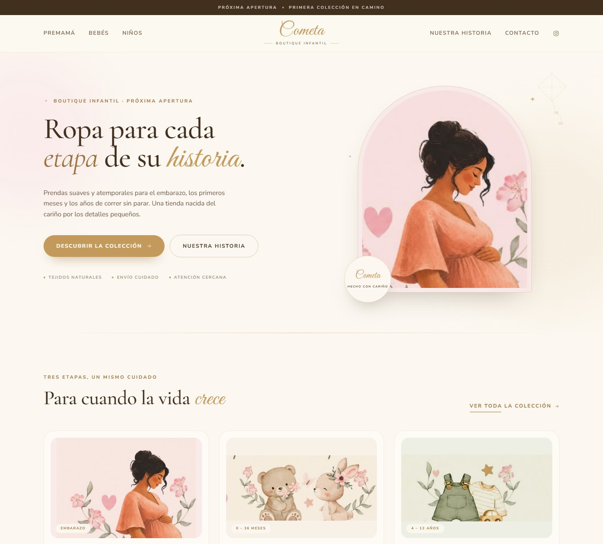
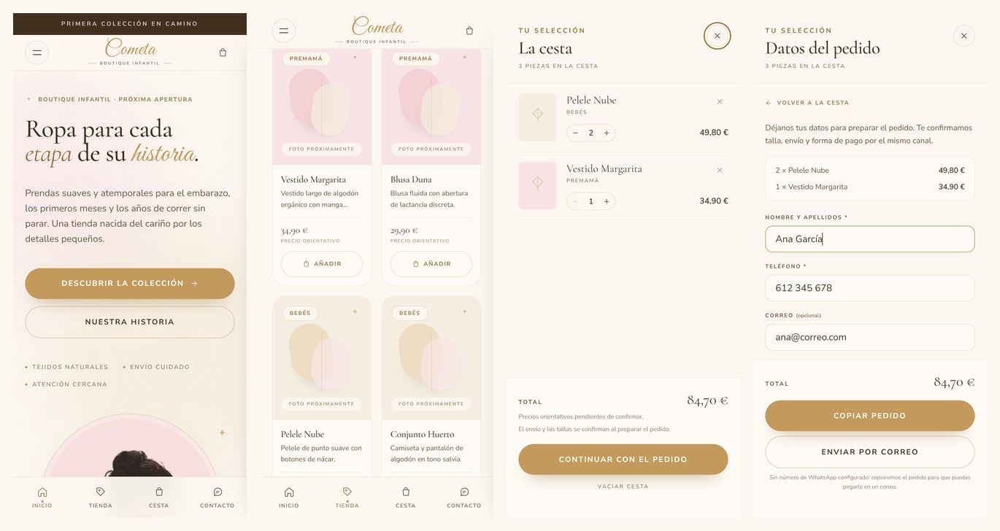

# COMETA · Boutique infantil

Sitio web de **COMETA**, una boutique de ropa para premamá, bebés (0–36 meses)
y niños (4–12 años). El proyecto está en fase de preapertura: el diseño y la
navegación ya funcionan, el catálogo y el carrito llegarán en las siguientes
fases.

> «Ropa para cada etapa de su historia.»

**Web en producción:** <https://cometa-alpha.vercel.app>



## Stack

- [Astro](https://astro.build) 5 — generación estática, HTML mínimo y navegación
  instantánea.
- [Tailwind CSS](https://tailwindcss.com) 4 — sistema de diseño con tokens.
- TypeScript para los datos del catálogo.
- Fuentes autoalojadas con Fontsource (Cormorant Garamond, Great Vibes y Nunito
  Sans). Sin peticiones a Google Fonts.
- Despliegue previsto: Vercel o Netlify (pendiente de conectar).

## Puesta en marcha

Node.js se instaló en modo portable dentro de `.tools/` (no requiere
administrador). Para esta sesión de PowerShell:

```powershell
$env:Path = "C:\Users\jeanm\Documents\COMETA\.tools\node-v26.13.0-win-x64;$env:Path"
npm install
npm run dev
```

El servidor arranca en <http://localhost:4321>.

| Comando | Acción |
| --- | --- |
| `npm run dev` | Servidor de desarrollo con recarga en caliente |
| `npm run build` | Genera el sitio estático en `dist/` |
| `npm run preview` | Previsualiza el resultado de producción |
| `npm run check` | Comprobación de tipos de Astro |

### Verla en el móvil

El servidor de desarrollo solo escucha en tu ordenador. Para abrirlo desde un
teléfono en la misma Wi-Fi:

```powershell
npm run preview -- --host 0.0.0.0 --port 4322
```

Y entra desde el móvil en `http://IP-DEL-PC:4322` (por ejemplo
`http://192.168.1.237:4322`). Si no carga, permite Node.js en el Firewall de
Windows. Para un túnel público temporal (Cloudflare, ngrok…) ya está activado
`preview.allowedHosts` en `astro.config.mjs`.

## Estructura

```text
src/
  components/     Header, Footer, tarjetas, ilustraciones SVG
  data/           Catálogo, categorías y textos legales
  layouts/        BaseLayout con SEO, fuentes y scripts globales
  pages/          Home, tienda, categorías, historia, contacto, legal
  styles/         Tokens de diseño y estilos base
public/
  brand/          Cartelera original e ilustraciones recortadas
docs/             Diseño, hoja de ruta y contenidos pendientes
assets/brand/     Original de la cartelera y recortes de trabajo
```

## Estado

- [x] Base técnica y sistema de diseño
- [x] Home, tienda con filtros por categoría, historia, contacto y legales
- [x] Navegación responsive y animaciones de entrada
- [x] Versión móvil con barra inferior, carruseles y productos a dos columnas
- [x] Carrito con persistencia local, cantidades y total
- [x] Datos de contacto y notas antes de enviar el pedido
- [x] Pedido por WhatsApp, correo o copia al portapapeles
- [ ] Número de WhatsApp real (al rellenarlo se activa el botón)
- [ ] Fotos y precios definitivos del catálogo
- [ ] Newsletter conectada a un proveedor
- [ ] Formulario de contacto conectado a un correo real
- [ ] Dominio definitivo y despliegue

## Experiencia móvil

La web está pensada primero para el teléfono:



- Barra inferior fija con Inicio, Tienda, Cesta (con contador) y Contacto.
- Cabecera compacta: menú a la izquierda, logotipo centrado y cesta a la derecha.
- Categorías en carrusel horizontal y filtros deslizables.
- Productos a dos columnas, con botón «Añadir» de 44 px.
- Cesta a pantalla completa y campos de 16 px para evitar el zoom automático de iOS.
- Respeto al `safe-area` en la barra inferior y en la cesta.

Capturas y comprobaciones en tamaño 390 × 844:

```powershell
npm run preview        # en una terminal
npm run shots          # capturas en la carpeta temporal
npm run check:mobile   # desbordamientos, menú y contadores
```

## Carrito y pedidos

La cesta se guarda en `localStorage` (clave `cometa:cesta:v1`): sobrevive a
recargas y se sincroniza entre pestañas. El importe se calcula siempre con los
precios de `src/data/site.ts`, nunca con lo que haya guardado el navegador.

Antes de enviar, el pedido pasa por un segundo paso donde se piden **nombre y
teléfono** (obligatorios) y, opcionalmente, correo y notas (talla, dedicatoria,
fecha…). Los datos se validan, se guardan en el navegador para la próxima compra
y se incluyen en el mensaje junto al resumen de piezas y el total.

Para activar el botón **Pedir por WhatsApp**, rellena el número en formato
internacional sin `+` ni espacios:

```ts
// src/data/site.ts
export const enlaces = {
  whatsapp: "34600123456",
  // ...
};
```

Mientras esté vacío, la cesta ofrece **Copiar pedido** y **Enviar por correo**
como alternativa, para que la tienda pueda recibir pedidos desde el primer día.

Los precios actuales son orientativos (`preciosProvisionales`). Al cambiarlos
por los definitivos, pon esa constante en `false` y el aviso desaparecerá.

## Documentación

- [`docs/diseno.md`](docs/diseno.md) — paleta, tipografía y componentes.
- [`docs/hoja-de-ruta.md`](docs/hoja-de-ruta.md) — fases y su reflejo en Jira.
- [`docs/contenidos-pendientes.md`](docs/contenidos-pendientes.md) — lo que
  falta por decidir con Vanesa.

## Repositorio y gestión

- Web: <https://cometa-alpha.vercel.app>
- GitHub: <https://github.com/jaxsullivan7/COMETA>
- Jira: proyecto `COM` en <https://jaxsullivan7.atlassian.net>
